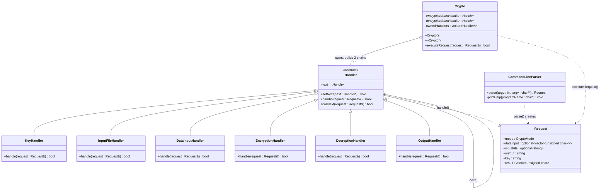
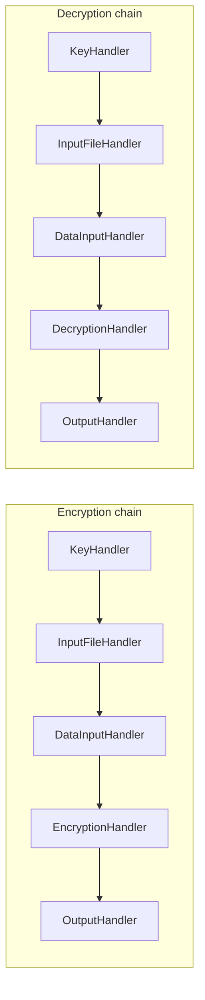

# Lab 9 - Chain of Responsibility

**Welcome!**

In today's lab, you will:

1. Implement the Chain of Responsibility Pattern
2. Use DES (Data Encryption Standard) to encrypt and decrypt data

## Before you start

This repo uses the **CodeRewind** VS Code extension to record your editing session (typed keystrokes, pastes, AI suggestion accepts) for later review. Set it up before you start coding:

1. Install the extension: open the **Extensions** view in VS Code (`Ctrl+Shift+X`), search for **CodeRewind**, and click **Install**. Or install it directly from the Marketplace: [https://marketplace.visualstudio.com/items?itemName=NabilMAl-Rousan.code-rewind](https://marketplace.visualstudio.com/items?itemName=NabilMAl-Rousan.code-rewind). If you have multiple VS Code profiles, right-click the extension and select **Apply Extension to all profiles**.
2. That's it! This repo already contains a `.coderewind-record` file at its root, so recording **starts automatically** the moment you open this folder in VS Code. A status bar item at the bottom right shows `CodeRewind: Recording` when it's active.
3. Just code normally. Sessions are saved to `.vscode/keylog/session-<timestamp>.jsonl` and are committed along with your other work (don't remove them or add `.vscode/keylog/` to your own `.gitignore`).
4. If you ever need to pause/resume recording manually, click the status bar item, or use **CodeRewind: Start Recording** / **CodeRewind: Stop Recording** from the Command Palette (`Ctrl+Shift+P`).
5. Ensure you commit and push your work frequently, at logical points in development, with sensible commit messages. Don't leave it all to one giant commit at the end.

---

## Background: Encryption, Decryption, and DES
> Read this section only if you are unfamiliar with encryption and decryption. If you already know what these are, feel free to skip ahead to "The DES Library" below.

**Encryption** scrambles plaintext into ciphertext using a secret **key**; **decryption** reverses that with the same key. Decrypting with the wrong key doesn't raise an error - it just produces garbage, so programs need their own way to detect that (see padding, below).

**DES (Data Encryption Standard)** is a 1970s-era **symmetric block cipher**: it encrypts data in fixed 8-byte chunks, one block at a time. An 8-byte key is "single DES"; chaining three DES passes with 2 or 3 distinct keys (16 or 24 bytes) gives **Triple DES**, a harder-to-brute-force variant of the same algorithm. DES is considered broken by modern standards - it's used here for its simplicity, not real-world security.

Since messages are rarely an exact multiple of 8 bytes, encryption **pads** the data up to the next full block, and decryption strips that padding back off. This lab uses PKCS#7 padding: padding that comes out looking wrong after decryption is how your Decryption Handler detects a bad key.

## The DES Library

There's no standard-library DES in C++, so this lab vendors a small, well-known **public domain** DES/Triple-DES implementation - [D3DES by Richard Outerbridge](https://github.com/jeroennijhof/vncpwd/blob/master/d3des.c) - in `des/d3des.c` / `des/d3des.h`, and wraps it in `des/DesCipher.hpp` / `des/DesCipher.cpp` behind two functions:

```cpp
std::vector<unsigned char> Des::encrypt(const std::vector<unsigned char> &key,
                                         const std::vector<unsigned char> &plaintext);
std::vector<unsigned char> Des::decrypt(const std::vector<unsigned char> &key,
                                         const std::vector<unsigned char> &ciphertext);
```

**You are not expected to modify `des/`** - just `#include "DesCipher.hpp"` and call `Des::encrypt`/`Des::decrypt` from your encryption/decryption handlers. Key size picks the algorithm automatically, exactly matching this lab's "valid length (8, 16, 24)" requirement:

| Key size | Algorithm |
|---|---|
| 8 bytes | single-length DES |
| 16 bytes | double-length (2-key) Triple DES |
| 24 bytes | triple-length (3-key) Triple DES |

Here's the full loop - encrypting a string, then decrypting it straight back into the original string - to see how the two functions fit together:

```cpp
#include <iostream>
#include <string>
#include <vector>
#include "des/DesCipher.hpp"

int main() {
    std::string key = "abcd1234";   // 8 bytes - single-length DES
    std::string message = "Attack at dawn";

    std::vector<unsigned char> keyBytes(key.begin(), key.end());
    std::vector<unsigned char> plaintext(message.begin(), message.end());

    std::vector<unsigned char> ciphertext = Des::encrypt(keyBytes, plaintext);
    std::vector<unsigned char> decrypted = Des::decrypt(keyBytes, ciphertext);

    std::string result(decrypted.begin(), decrypted.end());
    std::cout << result << std::endl;   // prints "Attack at dawn"
}
```

`ciphertext` is a few bytes longer than `plaintext` (padding, see below) and isn't printable text - that's expected. `decrypted` comes back byte-for-byte identical to `plaintext`, which is why converting it straight back into a `std::string` reproduces the original message exactly.

Both functions operate in ECB mode with PKCS#7 padding, so `encrypt()` always returns a ciphertext whose length is a multiple of 8 bytes (1-8 bytes longer than the plaintext), and `decrypt()` strips that padding back off. `decrypt()` throws `std::runtime_error` if the padding comes out invalid after decryption - in practice that almost always means the wrong key was used, which is the "handle exceptions" the Decryption Handler needs to do. `encrypt()`/`decrypt()` throw `std::invalid_argument` if the key isn't 8/16/24 bytes.

## Grading

This lab marked out of 10.

Group members: 2

For full marks this week, you must:

1. (8 points) Implement the Chain of Responsibility Pattern correctly and have the right output
2. (2 points) Follow modern C++ best practices, OO Design principles, and write good code.

## Requirements

It's time to implement a behavioral pattern. I usually find these to be a lot simpler and easier to understand. In this week's lab we will implement the Chain of Responsibility pattern to create a series of handlers that validate and parse user input followed by either encrypting or decrypting the data according to the options specified.

> A few things this lab needs weren't covered in the Week 1-10 lecture decks. [`Lab-09.pptx`](Lab-09.pptx) in this repo fills in: reading and writing **binary files** with `fstream` (text mode would silently corrupt your ciphertext), handling errors with **`try`/`catch`** (for the Decryption Handler's bad-key/bad-padding case), and **`std::optional`** (used throughout `Request.hpp` for fields that might not be set). The Chain of Responsibility pattern itself was covered in lecture - see `Week-10-Behavioral-Patterns-Observer-ChainOfResponsibility-Strategy-State-Mediator.pptx` in the shared repo.

Read through the whole lab before starting. Take a piece of paper and:

- Identify the different classes and their responsibilities
- Identify the different handlers that will be needed to process the request
- Start building your code up from the essential classes to add in extra functionality. That is, get two handlers working first, then add in the third, and so on.

## Building

```sh
cmake -S . -B build
cmake --build build
```

This produces `build/lab9` (or `build/lab9.exe` on Windows).

## User Input

This application is meant to be run from the command line. To learn how to do this, open up terminal in MacOS/Linux or cmd in windows. Navigate to the folder with the built executable and type in the following:

```sh
./lab9 -h
```

This will bring up a list of positional and optional arguments that can be provided. Many of these arguments will have a short form (e.g `-o`) and a long form (e.g. `--output`). Either one can be used. This part is already implemented for you in `CommandLineParser.hpp`/`CommandLineParser.cpp` - you do not need to modify `CommandLineParser::parse()`.

To correctly encrypt or decrypt data you will need:

- **Properly read and write from/to the file in binary format, NOT as text.** Open file streams with `std::ios::binary` (e.g. `std::ifstream(path, std::ios::binary)`) - without it, Windows will silently mangle `\n`/`\r` bytes in binary ciphertext.
- data to encrypt or decrypt
- the encryption or *decryption key*. This is a relatively short string that is used by the encryption or decryption algorithm to encode the data.

Here are some examples of possible ways to call the program. Some of the handlers in your program might want to validate the request.

- `./lab9 abcd1234 -s "Test Data to be encrypted"` This provides a string to be encrypted with the key `abcd1234`
- `./lab9 abcd1234 -f "input_file.txt"` This provides a text file with the required data that needs to be encrypted with key `abcd1234`
- `./lab9 -f "input_file.txt" abcd1234` This is the exact same command as the previous one
- `./lab9 abcd1234 --file "input_file.txt"` This is also the exact same command as the previous one. This uses the long form instead
- `./lab9 abcd1234 -f "input_file.txt" -m en` This is also the exact same command, but it explicitly sets the mode to encryption
- `./lab9 abcd1234 -f "input_file.bin" -m de` This provides a binary file with data that needs to be decrypted with the given key.
- `./lab9 abcd1234 -f "input_file.bin" -m de --output print` This is the exact same command as the previous one explicitly stating that the output should be printed to the console.

Open the code and take a look at it. Right now the handlers (the actual exercise) don't exist yet, and every method of `Crypto` is an empty stub. As a developer you may be asked to write command line tools for other developers - I've already written the argument parsing (`CommandLineParser::parse()` in `CommandLineParser.cpp`) for you, so you can focus on the pattern itself. For this lab, you do not need to modify that function.

## Encryption and Decryption

Right, let's get to it.

We will be using `Des::encrypt`/`Des::decrypt` (see "The DES Library" above) to encrypt and decrypt data. Both take and return `std::vector<unsigned char>` - a byte buffer. Since file reads/writes must be in binary (see above), and command-line strings are just ASCII text, converting between a `std::string` and a `std::vector<unsigned char>` is as simple as:

```cpp
std::string text = "Some string";
std::vector<unsigned char> bytes(text.begin(), text.end());

std::string textAgain(bytes.begin(), bytes.end());
```

**Ok, so what do I have to do exactly?**

Implement the Chain of Responsibility Pattern to create handlers that would process the input request. In `main.cpp`, I have included the code to take the command line arguments and assign them to an object of type `Request` (see `Request.hpp`). You will need to:

- Design a `Handler` base class/interface for the Chain of Responsibility pattern (not provided - this is part of the exercise).
- Identify all the handlers needed to validate and process the request
  - **Encryption handler** *suggestions*:
    - **KeyHandler**
      - ensure `request.key` is a valid length (8, 16, 24)
    - **InputFileHandler**
      - if `request.inputFile` has a value, reads data from that file (in binary mode!) into `request.dataInput`
    - **DataInputHandler**
      - ensure `request.dataInput` has a value and is non-empty
    - **EncryptionHandler**
      - use `Des::encrypt` to encrypt `request.dataInput` into `request.result`
    - **OutputHandler**
      - output `request.result` to console or file
      - Unencrypted data written to a file uses a `.txt` extension
      - Encrypted data written to a file uses a `.bin` extension
  - **Decryption Handler** *suggestions*
    - **KeyHandler**
      - ensure `request.key` is a valid length (8, 16, 24)
    - **InputFileHandler**
      - if `request.inputFile` has a value, reads data from that file (in binary mode!) into `request.dataInput`
    - **DataInputHandler**
      - ensure `request.dataInput` has a value, is non-empty, and its length is a multiple of 8 (valid DES ciphertext is always block-aligned)
    - **DecryptionHandler**
      - use `Des::decrypt` to decrypt `request.dataInput` into `request.result`, and handle the `std::runtime_error`/`std::invalid_argument` it can throw
    - **OutputHandler**
      - output `request.result` to console or file
      - Unencrypted data written to a file uses a `.txt` extension
      - Encrypted data written to a file uses a `.bin` extension

- Implement these according to the Chain of Responsibility Pattern.

### UML Class Diagram

Here's a UML class diagram of one way to implement this (the handler suggestions above, wired together):



Each chain is just the handlers linked in sequence via `setNext()`:



`main()` calls `CommandLineParser::parse()` to build a `Request`, then hands it to `Crypto::executeRequest()`, which picks `encryptionStartHandler` or `decryptionStartHandler` based on `request.mode` and calls `handle()` on it - each handler does its own validation/work on the shared `Request` and calls `callNext()` to pass it along, stopping early (returning `false`) if something's invalid.

Note the `Handler "1" --> "0..1" Handler : next_` line in the class diagram above - that's the recursive association that actually forms the chain (each `Handler` holds a pointer to the next one). It's a plain, non-owning association, not composition: `Handler` doesn't own the lifetime of what `next_` points to - `Crypto`'s `ownedHandlers` does (hence the composition/aggregation arrow from `Crypto` to `Handler`).

I've also included the stub for the class `Crypto` (`Crypto.hpp`/`Crypto.cpp`) which has the following stub methods:

- `Crypto()` This constructor should set up the two chains of handlers - one for encryption and one for decryption - and keep a pointer to the first handler of each chain (add whatever member fields your design needs to `Crypto.hpp`).
- `~Crypto()` Since this class allocates handlers with `new`, it needs to `delete` them here, or every `Crypto` object will leak memory.
- `executeRequest(Request &request)` This method accepts a request and starts executing the first handler in the appropriate chain, based on `request.mode`.

`CryptoMode` (in `Request.hpp`) is an `enum class` with two values, `EN` (Encryption) and `DE` (Decryption). It's used by `Crypto::executeRequest` to determine whether to run the encryption or decryption handlers.

After implementing the handlers and connecting them in `Crypto`'s constructor and `executeRequest()`, test your program to ensure that it can handle encrypting and decrypting strings in different scenarios. For example:

1. Encrypting a string from console or file and outputting to the screen or file
2. Decrypting a string from console or file and outputting to the screen or file

I've also included a **test.cmd** script that can be run on Windows via the command prompt. This test script will quickly run your code in a variety of scenarios (it builds the project first, then runs a round-trip encrypt/decrypt through both the console and files). Feel free to modify this file with new test cases. To run the script, enter the terminal, navigate to the lab folder, and type `test` and Enter.

Incremental and atomic git commits are expected.

## FAQ

**How do I print decrypted data (mode `DE`) to the console?**

```cpp
for (unsigned char byte : request.result)
{
    std::cout << static_cast<char>(byte);
}
```

**How do I print encrypted data (mode `EN`) to the console as hex?**

```cpp
for (unsigned char byte : request.result)
{
    std::cout << std::hex << static_cast<int>(byte);
}
std::cout << std::dec; // reset the stream back to decimal
```

